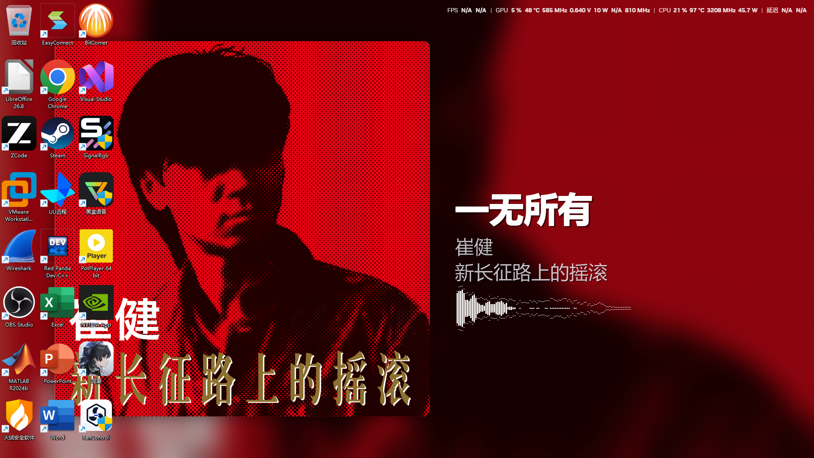

<div align="center">

# 🎵 AIMP Wallpaper

**让桌面壁纸跟着 AIMP 里正在播放的歌一起变**

专辑封面海报式动态壁纸 · AIMP 经典频谱面板 · 系统托盘

[](https://github.com/qiuyitao1528/aimp-wallpaper/releases/latest)
[](https://github.com/qiuyitao1528/aimp-wallpaper)
[](LICENSE)
[](https://www.aimp.ru/)

[下载](#-下载安装) · [功能](#-功能) · [设置](#-可调项) · [常见问题](#-常见问题) · [从源码构建](#-从源码构建)

</div>

---

<div align="center">

</div>

---

## ✨ 功能

| | 功能 | 说明 |
|---|---|---|
| 🖼️ | **海报式动态壁纸** | 切歌即换：封面 1:1 清晰居左、右侧歌名/歌手/专辑，背景四种方案（模糊 / 模糊+暗角 / 原图铺满 / 主色渐变）×九种模糊类型（高斯 / 方框 / 运动 / 缩放 / 像素化 / 中值 / 玻璃 / 景深 / 旋转），可跟随系统日/夜主题（夜间自动叠黑色遮罩）。封面不放大不裁剪，超屏才等比缩小 |
| 📊 | **AIMP 经典频谱面板** | 白条 + 点状峰值帽，与 AIMP 官方可视化同款（线性频率轴、WASAPI 环回自算 FFT）。可拖动、可锁定、可隐藏，无处可声时整列隐藏 |
| 🎨 | **排版全可调** | 歌名/歌手/专辑三行逐行独立：字号/字体/颜色/加粗/阴影/描边/过长处理、空格断行+括号断行（逐行）；封面大小与位置、行距、水平与垂直对齐——详见下方[可调项](#-可调项) |
| 🖥️ | **多显示器** | 逐屏按物理分辨率渲染；合盖断开的显示器自动跳过，不会拖垮整次渲染 |
| ⚡ | **低占用** | 频谱用 `UpdateLayeredWindow` 逐像素 alpha 原子呈现（Rainmeter / Lively 同思路），约 6~8% CPU；刷新率 10~120fps 可调 |
| 🔔 | **系统托盘** | 设置、显示/隐藏面板、恢复原壁纸、退出 |
| 💾 | **不弄脏桌面** | 首次运行自动记录原壁纸，退出时（可关）或卸载时自动恢复 |

---

## 📥 下载安装

前往 [**Releases**](https://github.com/qiuyitao1528/aimp-wallpaper/releases/latest) 下载，二选一：

<table>
<tr>
<td width="50%" valign="top">

### 🔧 安装版
`aimp-wallpaper-vX.Y.Z-setup.exe`

- 免管理员（装到当前用户）
- 自带开始菜单快捷方式
- 可选开机自启
- 可在「添加或删除程序」里卸载

</td>
<td width="50%" valign="top">

### 🟢 绿色版
`aimp-wallpaper-vX.Y.Z-win64.zip`

- 解压即用，不写注册表
- 配置生成在 exe 旁边
- 适合放 U 盘 / 便携使用

</td>
</tr>
</table>

> **环境要求**：Windows 10 / 11（64 位）+ [AIMP](https://www.aimp.ru/)（v5.40 实测；利用其自带的 Remote API，**无需装任何插件**）

---

## 🚀 使用

1. 启动 `AIMP Wallpaper`（首次运行会记录你当前的原壁纸）
2. 打开 AIMP 随便放首歌 —— 壁纸立刻变成海报
3. 右下角出现频谱面板；托盘出现图标

**托盘右键菜单**：设置… / 显示·隐藏频谱面板 / 恢复原壁纸 / 退出
**频谱面板右键**：锁定（禁拖动，仍跟随壁纸）/ 跟随壁纸位置 / 隐藏 / 退出

> 退出程序时默认把壁纸恢复成你原来的那张（可在设置 → 系统里关掉）。
> 也可以随时手动恢复：`aimp-wallpaper.exe restore`

---

## ⚙️ 可调项

设置窗口分五页，全部即改即生效（保存后壁纸立刻重渲染，不用重启）：

| 页签 | 内容 |
|---|---|
| **壁纸** | 背景方案（模糊 / 模糊+暗角 / 原图铺满 / 主色渐变）、模糊类型（高斯 / 方框 / 运动 / 缩放 / 像素化 / 中值 / 玻璃 / 景深 / 旋转）、模糊强度、跟随系统日/夜主题（夜间叠黑色遮罩+浓度）、封面大小倍率（0.5~1.6）、封面 X 偏移、封面 Y 偏移 |
| **文字** | 歌名/歌手/专辑三行**逐行独立**：字号（像素）、字体（自动枚举系统全部字体）、颜色（取色器）、加粗、过长处理（换行 / 省略号）、阴影（逐行开关）、描边（逐行宽度+描边色）；空格断行（逐行，折行点附近遇空格优先断在空格后）、括号断行（逐行开关：断点落在括号组内时吸收闭合括号或整组下移） |
| **排版** | 标题-副行间距、标题行间距、副行行间距、文字 X 偏移、文字 Y 偏移、水平对齐（左/中/右）、垂直对齐（顶/中/底） |
| **面板** | 频率面板刷新率（15~120fps）、锁定 |
| **系统** | 开机自启、退出时恢复原壁纸 |

> 偏移量可以直接键入数值（支持负数）。频谱面板的自动位置跟着文字块底部走，调排版时会一起挪。

---

## ❓ 常见问题

<details>
<summary><b>壁纸不跟着歌变？</b></summary>

先看日志：`%LOCALAPPDATA%\aimp-wallpaper\aimp-wallpaper.log`

最常见的两个原因：
- **AIMP 没在运行**：程序会每 5 秒重连，AIMP 起来后自动恢复
- **有显示器处于断开状态**（例如笔记本合盖外接屏）：已修复；若仍遇到，把日志发到 Issue 里
</details>

<details>
<summary><b>频谱面板不动 / 是空的？</b></summary>
面板数据来自系统声音的 WASAPI 环回采集。没有任何声音输出时，所有条会整列隐藏（这是正常表现）。如果一直空白，检查系统是否有可用的输出设备。
</details>

<details>
<summary><b>在线电台没有封面 / 没有歌词？</b></summary>
在线流常常不带封面，此时会显示深色占位框（正常）。
</details>

<details>
<summary><b>开机自启在哪里开关？</b></summary>
设置 → 系统 → 开机自启动。它与安装时勾选的"开机自启动"是同一个启动项。
</details>

---

## 🔨 从源码构建

```bash
# 运行（需要 Python 3.12+ 与 uv）
uv run python -m aimp_wallpaper          # 启动
uv run python -m aimp_wallpaper restore  # 恢复原壁纸

# 打包 exe
uv run pyinstaller --noconfirm --clean --windowed --name aimp-wallpaper \
  --icon assets/icon.ico --add-data "assets/icon.png;." \
  --collect-all pyaudiowpatch --collect-all pystray run.py

# 生成安装包（需要 Inno Setup 6+）
iscc installer.iss
```

---

## 🔍 原理

<details>
<summary><b>展开技术细节</b></summary>

- **数据源**：AIMP 自带 Remote API（`AIMP2_RemoteInfo` 窗口消息 + 共享内存 + `WM_COPYDATA` 封面推送），零插件依赖。协议常量按本机 AIMP v5.40.2727 实测校准
- **封面**：`GET_ALBUMART(29)` → AIMP 回推 `WM_COPYDATA`（`dwData=0x41495043`，图片字节流）。切歌瞬间 AIMP 常未解析好封面，故带 10 秒重试窗口
- **元数据**：共享内存 2048 字节，`0x00`=字符串区偏移(0x58)，`0x28` 起依次 Album/Artist/Date/FileName/Genre/Title 字符长度，`0x58` 起紧凑 UTF-16
- **频谱**：AIMP 官方可视化本身就是线性频率轴直出 FFT bin（见其 `apiVisuals.h`），本项目对齐该实现；采集走 WASAPI 环回（pyaudiowpatch），帧间做时间线性插值
- **渲染**：PIL 逐屏渲染，PNG 输出；模糊背景先降采样到 1/3 再模糊回放大（约 10 倍提速）；封面与背景按内容哈希缓存
- **覆盖窗口**：Win11 26300 上 `SetParent` 进 Progman/WorkerW 的窗口不会被 DWM 合成，因此改用**顶层窗口 + `UpdateLayeredWindow` 逐像素 alpha + `SetWindowPos` 把 Progman 压到窗口下方**（Rainmeter / Lively 同思路）
- **设壁纸**：comtypes 手写 `IDesktopWallpaper`（IID `B92B56A9-8B55-4E14-9A89-0199BBB6F93B` —— 网上常见 IID 有误），逐屏 `SetWallpaper`

</details>

---

<div align="center">

**License** · [MIT](LICENSE)

如果它让你的桌面好看了一点，欢迎点个 ⭐

</div>
